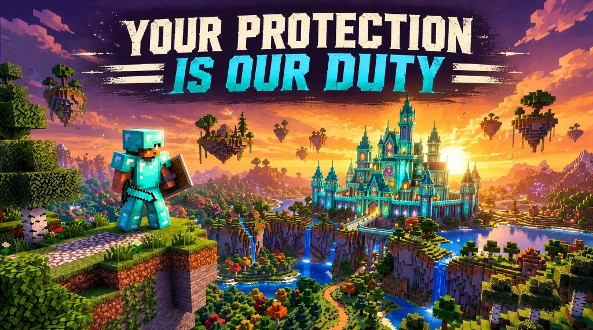
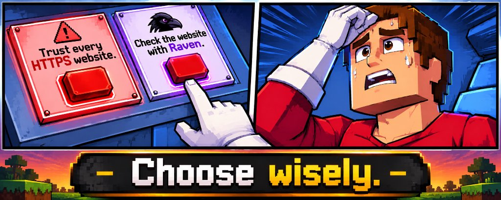
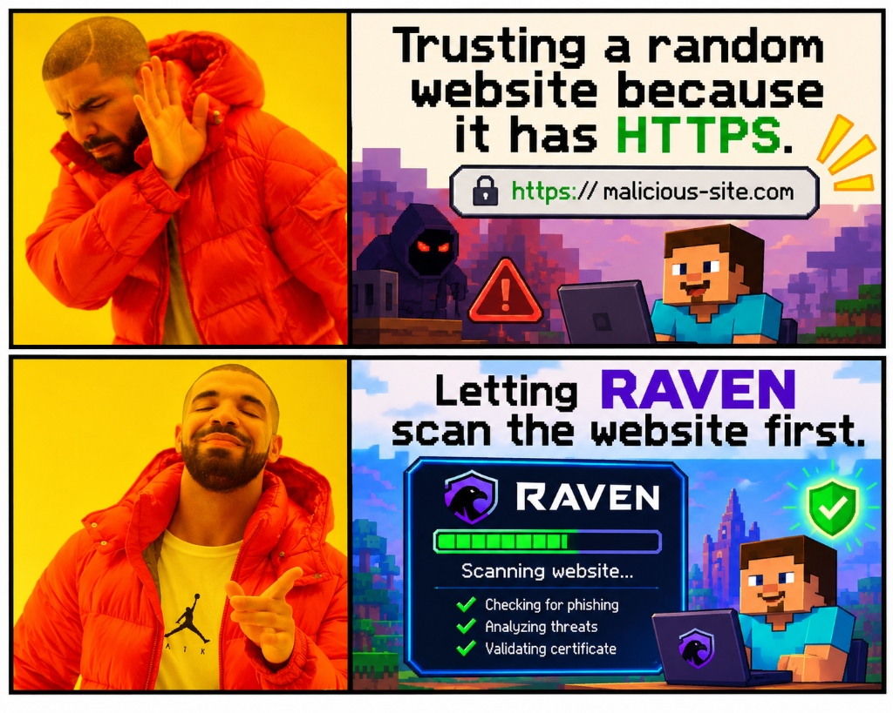

<div align="center">



# 🦅 RAVEN
### Autonomous Cybersecurity Intelligence & Threat Defense Platform

[](https://raven-alpha-hazel.vercel.app)
[](https://fastapi.tiangolo.com)
[](https://python.org)
[](https://react.dev)
[](https://vitejs.dev)
[](https://tailwindcss.com)
[](LICENSE)

<p align="center">
  <strong>"Your Protection Is Our Duty."</strong><br>
  Evidence-driven web threat intelligence, hop-by-hop SSRF defense, AI-powered intelligence briefings, and automated GitHub repository security audits — guided by an interactive companion Cyber Sentinel.
</p>

[🌐 Live Web Platform](https://raven-alpha-hazel.vercel.app) • [✨ Overview](#-overview) • [🎯 Why RAVEN?](#-why-raven-the-https-dilemma) • [🔍 Website Scanner](#-website-security-scanner) • [🛡️ GitHub Scanner](#-github-repository-security-health-check) • [⚖️ Risk Scoring](#-risk-scoring--verdict-engine) • [⚡ Quick Start](#-quick-start)

</div>

---

## 🎯 Why RAVEN? (The HTTPS Dilemma)

> *"A green padlock only means your connection to the server is encrypted. It does NOT mean the website isn't an active phishing campaign or stealing your credentials!"*

<div align="center">
  <table>
    <tr>
      <td align="center" width="50%">
        
        <br>
        <em>🤔 The daily web security struggle: choose wisely!</em>
      </td>
      <td align="center" width="50%">
        
        <br>
        <em>🛡️ Smart security: Let RAVEN verify before you trust.</em>
      </td>
    </tr>
  </table>
</div>

---

## 🌟 Overview

**RAVEN** is a modern, full-stack cybersecurity platform designed to eliminate false positives, detect hidden infrastructure deception, and make security investigations transparent, explainable, and visually engaging.

* **🌐 Multi-Source Website Threat Telemetry**: Combines Google Safe Browsing, VirusTotal v3 vendor consensus, URLhaus malware feeds, passive TLS certificate validation, and lexical domain heuristics.
* **🛡️ Hardened SSRF Defense Engine**: Comprehensive protection against Server-Side Request Forgery, loopback probing (`127.0.0.0/8`, `::1`), private subnets (RFC 1918), link-local cloud metadata (`169.254.169.254`), decimal/hex integer IP bypasses, and redirect loops.
* **🧠 AI Intelligence Briefing**: Powered by Gemini with structured validation and a deterministic fallback engine — strictly enforces evidence provenance, explains limitations, and never hallucinates fake threats.
* **🔍 GitHub Repository Security Health Check**: Ingests public repositories and runs multi-engine static analysis (Gitleaks, Semgrep, Google OSV API) with automated secret masking.
* **⚔️ Companion Cyber Sentinel**: An expressive pixel-art companion that reacts dynamically to authoritative scan verdicts with custom retro cursor interaction and particle physics.
* **🔗 Public Shareable Reports**: Cryptographically unguessable share IDs (`RVN-XXXXXXXX`), instant clipboard copying, one-click PDF generation, and owner link revocation.

---

## 🔍 Website Security Scanner

Inspect any target domain or full URL (`https://example.com/login`):

```
  [Target URL Input]
          │
          ├──> SSRF Fast-Path Filter (Blocks 127.0.0.1, 169.254.169.254, RFC 1918, Private DNS)
          │
          ▼
  [Parallel Telemetry Engine]
          ├──> Google Safe Browsing v4 (Social Engineering, Malware, Unwanted Software)
          ├──> VirusTotal v3 API      (Multi-Vendor Consensus & Historical Reputation)
          ├──> URLhaus Database       (Active Malware Payload & C2 Tracking)
          ├──> Passive TLS Probe      (Certificate Chains, SAN/CN Validity, Expiration)
          ├──> Lexical Heuristics     (Punycode/IDN, Brand Spoofing, High-Risk TLDs, Tokens)
          └──> Safe DOM Inspector     (Hop-by-Hop Redirect Tracking, Form Credential Exfiltration)
          │
          ▼
  [Authoritative Risk Engine]  ──> Strict 0–100 Scale, Deduplication & Severity Provenance
          │
          ▼
  [AI Intelligence Briefing]   ──> Gemini Executive Summary, Impact & Remediation Blueprint
          │
          ▼
  [Interactive Dossier UI]     ──> Sentinel Reaction + Risk Hero + Incident Breakdown + Raw JSON
```

### Key Detection Capabilities:
1. **Accurate Punycode & Homograph Analysis**: Distinguishes benign foreign-language IDNs (e.g., `münchen.de`) from deceptive homographs spoofing protected brands.
2. **Credential Exfiltration Detection**: Differentiates legitimate same-origin authentication forms (e.g. `github.com/login`) from external credential theft forms submitting passwords to unauthorized third parties.
3. **Official EICAR Contextualization**: Identifies standardized EICAR anti-malware test artifacts on `eicar.org` as benign research verification files, preventing false critical alarms.
4. **URL Shortener Expansion**: Follows redirect chains safely to analyze final destinations; reports destination limitations honestly if unexpanded.
5. **Honest Inconclusive Reporting**: Unresolvable domains (NXDOMAIN) and network timeouts are classified as unresolvable / incomplete coverage, never falsely reported as confirmed malware.

---

## 🛡️ GitHub Repository Security Health Check

Inspect any public GitHub repository or user profile (`https://github.com/owner/repo` or `owner/repo`):

| Engine | Target | Description |
| :--- | :--- | :--- |
| **Gitleaks** | Hardcoded Secrets | Detects AWS tokens, GitHub PATs, private RSA keys, and database URLs. **All secrets are automatically masked** (`ghp_****cdef`). |
| **Semgrep** | SAST Vulnerabilities | Scans for SQL injection, dangerous execution (`eval`, `exec`, `subprocess`), and unsafe DOM assignments. |
| **Google OSV** | Vulnerable Dependencies | Queries `api.osv.dev` against `package.json`, `requirements.txt`, `go.mod`, `cargo.lock`, and `pom.xml`. |
| **PolyGuard** | Code Classification | Experimental deep-learning heuristic classifier. |
| **AI Remediation** | Developer Blueprint | Synthesizes findings into prioritized, step-by-step developer remediation guidance. |

---

## ⚖️ Risk Scoring & Verdict Engine

RAVEN enforces a single authoritative 0–100 scoring system across the frontend, backend, API, and exported PDF reports:

| Score Tier | Risk Category | Classification | Meaning |
| :---: | :--- | :--- | :--- |
| **0 – 19** | `LOW RISK` | Clean / Safe | Verified clean across threat feeds, valid TLS, zero brand impersonation. |
| **20 – 39** | `MODERATE RISK` | Hygiene / Notice | Security hygiene notices (e.g. plaintext HTTP) or unverified shortener destinations. |
| **40 – 59** | `SUSPICIOUS` | Caution Advised | Heuristic anomalies, lookalike brand similarity, or unconfirmed vendor flags. |
| **60 – 79** | `HIGH RISK` | Elevated Threat | Elevated threat indicators, deceptive homographs, or untrusted/expired TLS chains. |
| **80 – 100** | `CRITICAL RISK` | Confirmed Threat | Confirmed blacklisted malware, active phishing campaigns, or credential exfiltration. |

---

## 🛠️ Technology Stack

### Frontend:
* **Framework**: [React 19](https://react.dev/)
* **Build Tooling**: [Vite 8](https://vitejs.dev/) with Rolldown compilation
* **Styling**: [Tailwind CSS v4](https://tailwindcss.com/) & Handcrafted Pixel Art CSS
* **Typography**: Press Start 2P, Space Grotesk, Inter, JetBrains Mono
* **Icons**: [Lucide React](https://lucide.dev/)
* **Linter**: [Oxlint](https://oxc.rs/)

### Backend:
* **Framework**: [FastAPI](https://fastapi.tiangolo.com/) (Python 3.12+)
* **Server**: [Uvicorn](https://www.uvicorn.org/)
* **Database**: MongoDB (via [Motor](https://motor.readthedocs.io/)) with automatic in-memory fallback
* **Safe HTTP Client**: [HTTPX](https://www.python-httpx.org/) with hop-by-hop SSRF validation
* **AI Intelligence**: Google Gemini REST API (`gemini-2.5-flash` / `gemini-flash-lite`)

---

## ⚡ Quick Start

### 1. Clone the Repository
```bash
git clone https://github.com/soumik7484-art/Raven.git
cd Raven
```

### 2. Frontend Setup
```bash
# Install Node dependencies
npm install

# Start Vite frontend dev server
npm run dev
```
Frontend runs at: `http://localhost:5173`

### 3. Backend Setup
```bash
# Create and activate Python virtual environment
python -m venv backend/.venv

# Windows (PowerShell):
backend\.venv\Scripts\Activate.ps1
# macOS/Linux:
source backend/.venv/bin/activate

# Install backend dependencies
pip install -r requirements.txt

# Start FastAPI backend server
uvicorn main:app --app-dir backend --port 8000 --reload
```
Backend API docs (Swagger UI) run at: `http://127.0.0.1:8000/docs`

---

## 🧪 Running the Test Suite

RAVEN includes a comprehensive automated regression test suite:

```bash
# Run all backend unit & regression tests
python -m unittest discover backend/tests

# Run 12-case pre-deployment audit & SSRF test suite
python -m unittest backend/tests/test_audit_hardening_12_cases.py

# Run API integration tests
python -m unittest backend/tests/test_api_integration.py

# Run frontend incident normalizer & modal resolution tests
node tests/test_incident_normalizer.mjs
node tests/test_modal_resolutions.mjs
node tests/test_share_feature.mjs

# Production frontend build
npm run build
```

---

## 🔒 Security & Privacy Commitments

* **Zero Credential Persistence**: Discovered secrets and authentication tokens are masked in-memory and never written to logs or databases.
* **Passive Analysis Bounds**: Scans only publicly accessible resources and respects rate limits. Never executes arbitrary repository code.
* **Strict SSRF Isolation**: Outbound requests strictly forbid private IP ranges, loopback adapters, and internal cloud metadata interfaces.
* **No Authentication Lock-in**: Full public security scanning functionality is available without requiring user registration.

---

<div align="center">
  <sub>Built with 🦅 for transparent, evidence-driven cybersecurity intelligence. © 2026 RAVEN.</sub>
</div>
